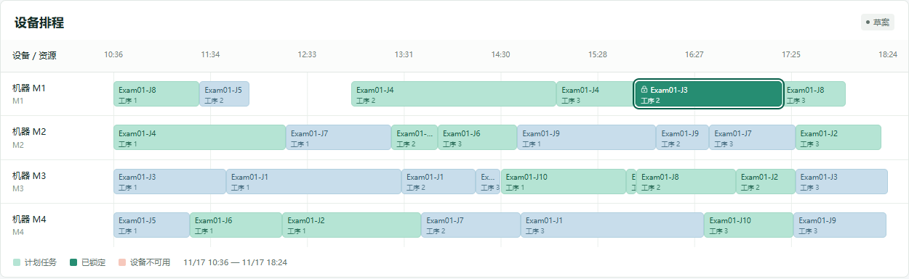
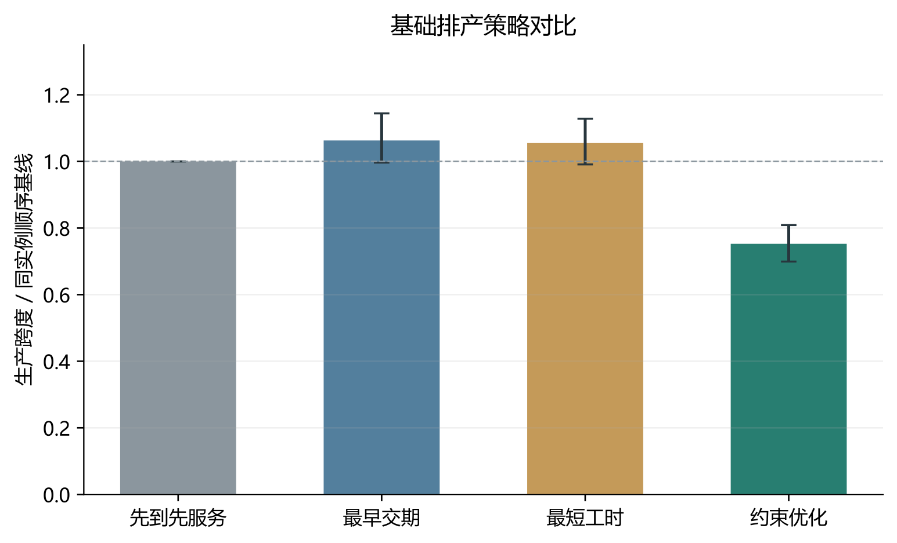
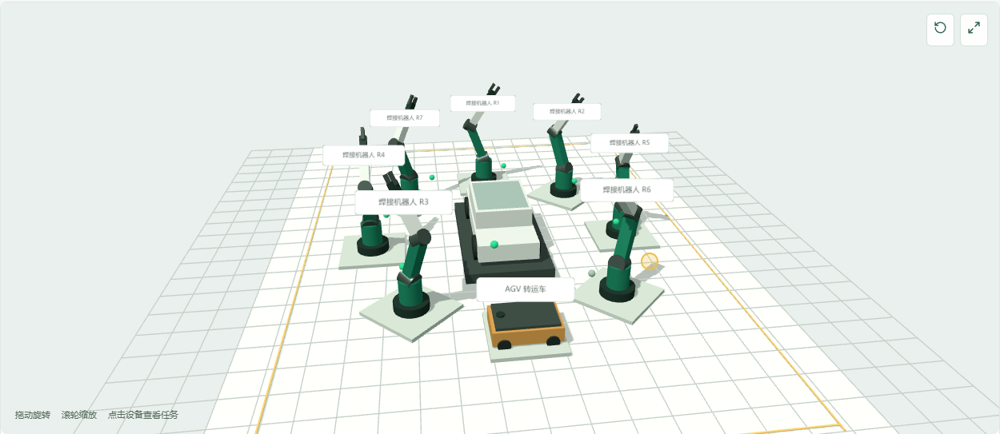

# 交期管家 · Jiaoqi Manager

面向小批量制造的订单异常与动态排产智能体。将订单、设备、工艺、日历和材料条件转化为可计算约束，连接候选排程、异常重排、独立校验、审核发布与三维回放。

**技术栈：** React · TypeScript · Three.js · FastAPI · SQLite · OR-Tools CP-SAT · Kimi



## 主要功能

- 登录注册、会话与工作区角色权限。
- 订单工艺、候选设备、工作日历、物料与交期试算。
- CP-SAT排程、任务锁定、冻结窗口、异常影响分析与重排。
- 独立约束校验、双角色审批、版本检查与计划发布。
- Kimi多模态助手、业务工具调用与会话管理。
- Three.js设备选择、视角交互及时间线回放。
- 国内公开制造数据导入、算法对照实验、指标导出。

## 快速启动

使用Python 3.12，在仓库根目录执行：

```bash
python -m venv .venv
# Windows PowerShell
.venv\Scripts\Activate.ps1
# Linux/macOS: source .venv/bin/activate
python -m pip install -r app/requirements.txt
python start.py
```

打开 **http://127.0.0.1:8788**，首次注册建立管理员账号；创建工作区，在“数据与实验”导入Exam01。仓库包含已构建前端，可直接启动。排程与三维功能在本机运行；智能助手通过“工作区设置—模型连接”配置个人Kimi密钥，或在本机`.env`中设置`MOONSHOT_API_KEY`。

[完整部署与操作流程](docs/部署与复现.md) · [数据来源与许可](DATA_LICENSES.md) · [实验协议](docs/实验说明.md) · [华为云开发实践](docs/华为云开发实践.md)

## 核心算法与实验

| 内容 | 实现 |
|---|---|
| 设备选择、工序时间、日历与停机约束 | `app/backend/scheduling/engine.py` |
| 独立可行性校验 | `app/backend/scheduling/validator.py` |
| 业务异常影响分析 | `app/backend/services/impact.py` |
| 研究局部重排、基线与约束优化 | `app/research/engine.py` |
| 交期两阶段优化 | `app/research/delivery.py` |
| 三维设备几何与交互模型 | `app/frontend/src/pages/Workshop.tsx` |

归档包含22个不同实例、693次运行（441次基础/动态实验＋252次交期实验），全部通过独立约束校验。统一单线程、5秒预算、种子0/1/2。

| 指标 | 归档结果 |
|---|---:|
| 基础排产平均配对归一化跨度改善 | 24.74% |
| 全局重排相对顺序修复的跨度改善 | 16.75% |
| 局部重排平均变更工序数 | 8.52道 |
| BIW-43、预算80的最优跨度 | 1647.9秒 |
| 包装组SPT相对FCFS的总延期减少 | 22.96% |



```bash
# 运行自动化测试
python -m pytest -q app/tests
# 焊装：3个种子、7种方法，共21次
python app/scripts/复现实验.py --suite biw --workspace 999
# 完整实验：693次
python app/scripts/复现实验.py --suite full --seconds 5 --seeds 3 --workspace 999
```

归档数据保存在`experiments/1`；新运行写入对应工作区目录。详细指标定义、工时转换和停机协议见[实验说明](docs/实验说明.md)。

## 华为云开发与部署

项目使用华为云码道CodeArts代码智能体开发核心后端，结合国内数据适配、独立校验和回归测试完成集成；应用部署于华为云AI开发者空间持久化环境，通过DevBridge提供HTTPS交互入口。当前业务存储采用SQLite，模型接口采用Kimi。

[在线Demo](https://ooaeomhn-8788.devbridge-s2.hwtunnel.com) · [开发与部署说明](docs/华为云开发实践.md)



## 开发

```bash
cd app/frontend
npm ci
npm run build
```

前端重建使用Node.js 22.12+，开发接口与模型保存在`app/`。数据库、账号、密钥及会话由每位部署者在自己的运行环境创建。

## 许可

项目原创代码采用[MIT许可证](LICENSE)。`data/`中的第三方资料保留CC BY 4.0及原作者署名，具体来源与转换方式见[DATA_LICENSES.md](DATA_LICENSES.md)。依赖组件遵循各自许可证。
